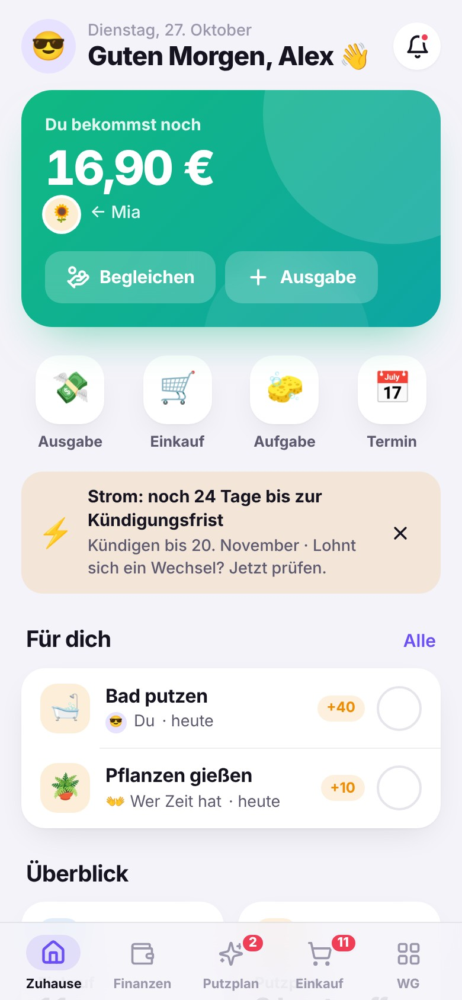
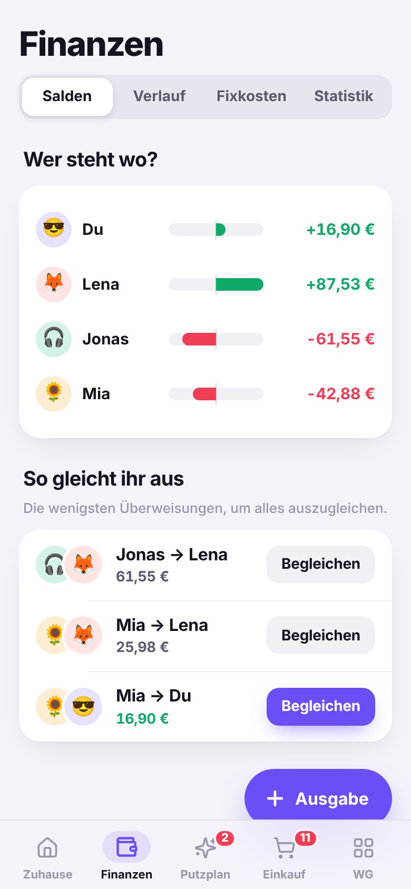
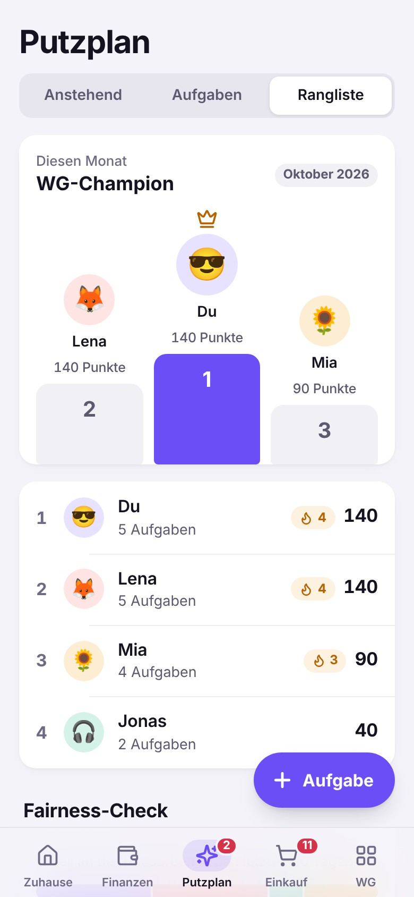
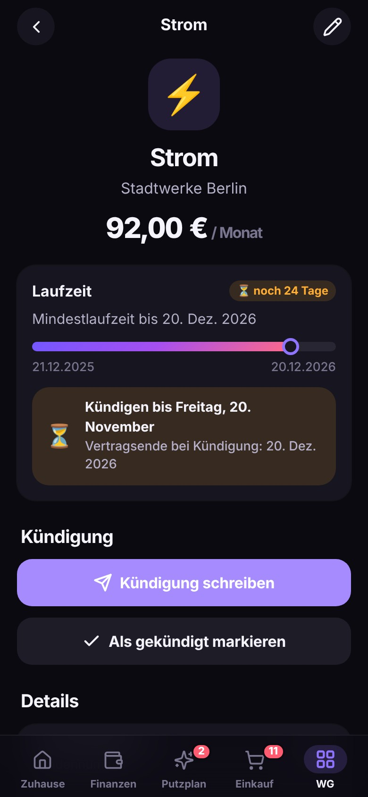

<div align="center">


# Nestly

**Die App für eure WG.** Geld fair teilen, Putzplan mit Rotation, Einkaufslisten, Verträge
mit Kündigungsfristen, Fixkosten und Kalender – endlich an einem Ort.

Kostenlos · Keine Werbung · Keine Tracker · Offline-fähig · Deutsch & English

<br />






</div>

---

## Was Nestly kann

| | |
| --- | --- |
| 🧭 **Einrichtung** | Assistent nach dem Gründen: Wohnung & Vermietung, Mitbewohnis + Einladung, Miete & Fixkosten (Strom, Internet, Rundfunk …), Putzplan mit Putztag, Einkaufslisten, WLAN – jeder Schritt überspringbar, jederzeit fortsetzbar |
| 🏠 **Zuhause** | Saldo, eigene Aufgaben zum Abhaken, Schnellaktionen, Bento-Übersicht, Fristen-Warnungen, Neuigkeiten |
| 💸 **Finanzen** | Ausgaben gleich / nach Anteilen / Beträgen / Prozent teilen, Salden, Ausgleich mit minimaler Anzahl Überweisungen, PayPal.me & IBAN, Statistik, CSV-Export |
| 🔁 **Fixkosten** | Miete, Strom, Internet, Abos werden am Fälligkeitstag automatisch gebucht und geteilt |
| ✨ **Putzplan** | Reihum, fair nach Punkten, feste Person oder offen · fester oder flexibler Rhythmus · Urlaubsmodus · Punkte, Podium, Streaks, Fairness-Check |
| 🛒 **Einkauf** | Listen pro Laden (Supermarkt, dm, IKEA …), Mengen-Erkennung, automatische Sortierung nach Gängen, Vorschläge, Einkauf → geteilte Ausgabe |
| 📄 **Verträge** | Fristen-Radar nach deutschem Verbraucherrecht, Erinnerungen, Kündigungsschreiben-Generator, Kundennummern zum Kopieren |
| 📅 **Kalender** | Termine, Besuch, Handwerker, Abwesenheiten + automatisch Putzplan, Zahlungen, Fristen und Geburtstage |
| 📌 **Pinnwand** | Sticky Notes mit Reaktionen, Hausregeln |
| 📶 **WLAN** | QR-Code für Gäste |
| 👋 **Einladen** | Code, Link, QR oder WhatsApp – ohne E-Mail, ohne Passwort; Platzhalter-Profile für alle, die noch keine App haben |
| 🔔 **Benachrichtigungen** | Web Push, wenn Mitbewohnis etwas eintragen, und morgens „Heute dran: Bad putzen“ inkl. Fristwarnungen |
| 📲 **Wie eine native App** | Installierbar, offline, App-Icon-Badge mit offenen Aufgaben, Teilen-Ziel (Zutatenliste aus einer Rezept-App → Einkaufsliste), Haptik, Dark Mode |

Mehr zur Produktidee, Zielgruppe, Positionierung und Roadmap: **[docs/CONCEPT.md](docs/CONCEPT.md)**.

## Schnellstart

Voraussetzung: **Node.js ≥ 22.18** (der Server läuft ohne npm-Abhängigkeiten direkt aus TypeScript).

```bash
npm install          # nur Dev-Tools: TypeScript, Typen, Playwright
npm run build        # baut die Web-App nach app/dist
npm start            # Sync-Server + App auf http://localhost:8787
```

Öffne <http://localhost:8787>, tippe auf **„Erstmal umschauen“** für die Demo-WG oder gründe
eine eigene WG und öffne den Einladungslink in einem zweiten Browserfenster – Änderungen
erscheinen in Echtzeit auf beiden Geräten.

| Befehl | Zweck |
| --- | --- |
| `npm run dev` / `npm run watch` | Neu bauen bei Änderungen (dazu `npm start` in einem zweiten Terminal) |
| `npm run typecheck` | TypeScript-Prüfung für core, server und app |
| `npm test` | Unit-Tests (Domänenlogik, QR-Encoder) und Server-Tests |
| `npm run test:e2e` | End-to-End mit zwei echten Browser-Geräten gegen den echten Server |
| `node scripts/screenshots.mjs` | Store-/README-Screenshots (hell & dunkel) |
| `npm run icons` | App-Icons aus dem Logo rendern |

## Selbst hosten

```bash
docker compose up -d                 # App + Sync-Server, Daten im Volume nestly-data
# oder ohne Compose:
docker build -t nestly . && docker run -p 8787:8787 -v nestly-data:/data nestly
```

Jeder Push auf `main` baut außerdem ein Image nach `ghcr.io/emilio1818-cloud/wg`. Für Fly.io
liegt eine `fly.toml` bei.

| Variable | Standard | Bedeutung |
| --- | --- | --- |
| `PORT` / `HOST` | `8787` / `0.0.0.0` | Adresse des Servers |
| `DB_PATH` | `server/data/nestly.db` | SQLite-Datei (im Container `/data/nestly.db`) |
| `STATIC_DIR` | `app/dist` | Ausgelieferte Web-App |
| `TRUST_PROXY` | – | `1` hinter einem Reverse Proxy (für Rate-Limits) |
| `CORS_ORIGIN` | `*` | Erlaubte Origin für die API |
| `RATE_LIMIT` | an | `0` schaltet Rate-Limits ab (nur für Tests) |
| `VAPID_PUBLIC_KEY` / `VAPID_PRIVATE_KEY` | automatisch | Web-Push-Schlüsselpaar (base64url); ohne Angabe beim ersten Start erzeugt und in der DB gespeichert |
| `VAPID_SUBJECT` | `mailto:push@nestly.app` | Kontakt für die Push-Dienste |
| `REMINDERS` | an | `0` schaltet die tägliche Push-Erinnerung (Putzplan, Kündigungsfristen) ab |
| `PUSH_ALLOW_ANY_HOST` | – | `1` erlaubt Push-Endpunkte außerhalb der bekannten Push-Dienste (FCM, Mozilla, Apple, Microsoft) |
| `NESTLY_SERVER_URL` *(Build)* | – | Sync-Server, den eine statisch gehostete App verwenden soll |

**Nur die App, ohne Server** (z. B. GitHub Pages): Die App funktioniert dann vollständig
offline auf einem Gerät; Einladungen und Sync lassen sich später in der App mit einem
Server verbinden. Der Workflow `.github/workflows/pages.yml` deployt auf Pages, sobald die
Repository-Variable `DEPLOY_PAGES=true` gesetzt ist.

## In die App Stores

Nestly ist eine vollwertige PWA (installierbar, offline, Icons, Shortcuts) und kommt über
Capacitor (iOS & Android) bzw. Trusted Web Activity (Google Play) und PWABuilder (Microsoft
Store) in die Stores. Anleitung: **[docs/APP_STORES.md](docs/APP_STORES.md)**.

## Architektur

```
core/     Domänenlogik ohne Abhängigkeiten (Splits, Salden, Fixkosten, Putzplan, Verträge)
server/   Sync-Server: node:http + node:sqlite, Einladungen, Token, Last-Write-Wins, SSE
app/      PWA in TypeScript/TSX mit kleiner Preact-kompatibler Laufzeit, Offline-Store, Sync
tests/    End-to-End-Tests mit Playwright (zwei Geräte)
```

Offline-first: Jedes Gerät hat alle Daten seiner WG lokal (IndexedDB) und gleicht Änderungen
über einen schlanken, generischen Record-Store ab. Details:
**[docs/ARCHITECTURE.md](docs/ARCHITECTURE.md)** · Protokoll: **[docs/SYNC_PROTOCOL.md](docs/SYNC_PROTOCOL.md)**.

## Datenschutz

Keine Werbung, keine Tracker, keine externen Schriftarten oder CDNs. Eure Daten liegen auf
euren Geräten und – wenn ihr synchronisiert – auf eurem Sync-Server. Kein Account mit
E-Mail oder Passwort: Geräte authentifizieren sich mit einem zufälligen Token, der Server
speichert nur dessen Hash. Backup-Export als JSON jederzeit in den Einstellungen.

---

<details>
<summary><b>English</b></summary>

**Nestly** is an all-in-one app for flatshares: split expenses (equal, shares, exact,
percent) with minimal settle-up transfers, recurring bills that book themselves, a rotating
chore plan with points and a fairness check, shared shopping lists per store, contracts with
notice-period tracking and a cancellation letter generator, a shared calendar, a pinboard
and Wi-Fi QR codes. It is an installable, offline-first PWA (German & English, light & dark)
with a zero-dependency Node sync server (`node:http` + `node:sqlite`).

```bash
npm install && npm run build && npm start   # → http://localhost:8787
```

See [docs/CONCEPT.md](docs/CONCEPT.md) (product concept, German),
[docs/ARCHITECTURE.md](docs/ARCHITECTURE.md) and [docs/APP_STORES.md](docs/APP_STORES.md).

</details>

MIT License
